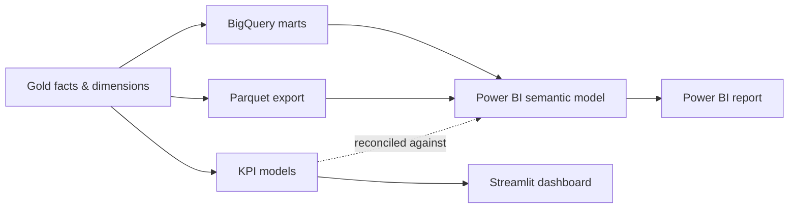

# Power BI semantic layer



The warehouse already answers every question the dashboard asks. This layer exists
because the answers are currently *only* reachable through Streamlit, and the tool
most analysts are hired to use is not Streamlit.

That makes it a genuine second consumer of the same Gold layer rather than a
rewrite — and a second consumer is the honest test of whether a star schema was
modelled well or merely modelled for the one app that happened to read it.

## What belongs where

Power BI is two products stacked: **Power Query** (ingestion and reshaping, in M)
and the **tabular model** (relationships, storage, and measures in DAX). The first
one is the one to leave almost empty here.

| This project | Power BI equivalent | Deliberate position |
|---|---|---|
| `stg_*` staging models | Power Query / M | **Near-empty.** dbt already did this, and it is tested |
| `dim_*` / `fact_*` | Model tables + relationships | Loaded as-is; no reshaping |
| `dim_date` | The date table (`Mark as date table`) | Already a gap-free spine, already Monday-based |
| `kpi_*` models | DAX measures | Rebuilt in DAX — **both are kept**, see below |
| `dim_period` | DAX time intelligence | Replaced by `CALCULATE` + `DATEADD` |
| dbt tests & contracts | *(no equivalent)* | Stays in dbt; nothing in Power BI replaces it |

Anything Power Query does here is invisible to the tests, invisible to `dbt docs`,
and invisible to the other two warehouses. The rule is therefore: if a
transformation is worth doing, it is worth doing in dbt where it is covered by a
`not_null`/`relationships` test and compiles on all three targets. Power Query
selects columns and sets types. Nothing else.

## Why the KPI models stay

A reasonable reading of the mapping above is that `kpi_summary`,
`kpi_sales_by_category`, `kpi_sales_by_weekday`, `kpi_sales_by_hour` and
`kpi_payment_methods` are now redundant: five period-aware models, each carrying
`prior_*` and `*_change_pct` columns at a `(period_label, key)` grain, collapse
into roughly eleven DAX measures. The grouping that each model does in SQL comes
free from whatever filters a visual applies.

They stay, for two reasons.

**The Streamlit dashboard reads them.** It queries DuckDB directly and has no DAX
engine. Deleting the models to avoid duplicating logic would mean deleting the
dashboard.

**The duplication is the point.** Two engines computing the same twelve figures
from the same rows is a testable claim, and `compare_dax_to_dbt.py` tests it the
way `compare_warehouses.py` tests the three warehouses: not that both ran, but
that both got the same answer. A measure that disagrees with its SQL counterpart
is nearly always a filter-context mistake — a missing `REMOVEFILTERS`, a
relationship pointed the wrong way, a `SUM` where the SQL had `DISTINCTCOUNT` —
and those are exactly the errors that produce a plausible number rather than an
error.

## Two sources, for the same reason there are three warehouses

**BigQuery (`prod`)** is the real connection. Native connector, cloud-to-cloud
scheduled refresh with no gateway, and the dataset the models already build into.
It currently holds **production data from the real store** — 153,330 order lines
and roughly $1.4M of net sales, two real locations — which is what makes it the
right source for the owner's own reporting and the wrong source for anything
published. See the publishing boundary below.

**`demo_marts` in BigQuery** is the publishable one: the same 33 models built from
a fully synthetic warehouse, in its own datasets (`demo_silver`, `demo_reference`,
`demo_marts`), sharing nothing with the real store's.

```bash
make demo-warehouse   # synthetic Bronze -> Silver -> Gold, in data/demo/
make demo-cloud       # -> demo_silver, demo_reference, demo_marts
```

**Parquet export** writes the marts to `powerbi/data/` off a local DuckDB
warehouse, so the semantic model opens with no credentials and no cloud account at
all. Same purpose as the DuckDB `dev` target. Two targets, because which warehouse
filled the directory matters:

```bash
make demo-powerbi-export   # from the synthetic warehouse — safe to publish
make powerbi-export        # from the production warehouse — private
```

Both write the same filenames to the same directory, so the model's connection
never changes; only the data behind it does. The script prints which warehouse it
read, because the files are otherwise indistinguishable.

Money stays in integer cents through the export, matching the convention the rest
of the project holds to — cents until the presentation layer. In Power BI the
presentation layer is the measure, so every money measure divides by 100 exactly
once, and no column is ever displayed raw.

## Storage mode

**DirectQuery against BigQuery**, with the dimensions set to **Dual**.

Not because DirectQuery is better — Import is faster and this warehouse is tens of
megabytes, so it would fit in memory many times over. The reasons are specific:

- Power BI Desktop does not run on macOS and never has. Browser authoring at
  powerbi.com does, as of the September 2026 release, but it authors **DirectQuery**
  models. Import-mode authoring still needs Desktop, and therefore Windows.
- DirectQuery keeps the semantic model honest. There is no imported copy to drift
  from the warehouse, so a reconciliation failure means the *measure* is wrong,
  which is the thing being tested.

Dimensions as Dual rather than DirectQuery because slicer lists and relationship
lookups otherwise cost a BigQuery query per interaction. `dim_item` is 6,921 rows
and `dim_location` is 2; caching them is free and removes most of the latency a
DirectQuery report is otherwise blamed for.

`maximum_bytes_billed` in the dbt profile does not apply to Power BI — it is a dbt
setting, not a BigQuery-side quota. A DirectQuery report issues a query per visual
per interaction, so cost control here is BigQuery custom quotas, not the profile.

## Date coverage limits what can honestly be compared

The warehouse currently spans **2025-07-26 to 2026-08-12 — 383 days**. That is a
little over one year, which has a specific consequence: `SAMEPERIODLASTYEAR` and
every year-over-year measure will return blank or partial for most of the range,
because the comparison window falls off the start of the data.

`dim_period` already encodes this honestly — on production, `prior_window_complete`
is `true` for the 7, 30 and 90-day windows and `false` for `Last 365 days` and
`All time`. The DAX measures must reproduce that behaviour rather than quietly
returning a number computed from a partial window.

The synthetic warehouse is deliberately built with **801 days (2.2 years)**, which
is why `Last 365 days` has a complete prior window there and year-over-year DAX can
actually be demonstrated. `DEMO_DAYS` controls it. This is the one place the demo is
*more* capable than production, and the reason is simply that fake history is free.

### How the two warehouses differ

The synthetic fixture is built to exercise the models rather than merely fill
them: 218 item variations across two locations on `America/Los_Angeles`, with a
Zipf-weighted popularity curve so rankings are decisive, trade split 62/38
between the stores, and an evening demand peak generated in store-local wall
clock and converted to UTC on the way out. Category mix lands at roughly 45%
liquor, 27% wine, 22% beer.

Two differences still matter when building visuals:

- **It reconciles perfectly.** `assert_order_payment_reconciled` warns on 1,901
  real orders and zero synthetic ones. A visual built to surface reconciliation
  variance looks empty on the demo and busy on production.
- **Production's extract is stale, which silences the reorder signal.**
  `kpi_inventory_position` anchors its trailing-30-day velocity on `current_date`,
  while `dim_period` anchors on the latest day with sales. The real extract ends
  2026-08-12, so on production every one of the 1,585 rows reads
  `no_recent_sales` and `days_of_inventory` is null. The demo, generated up to
  today, shows a real spread. Pre-existing, and worth knowing before you build a
  reorder visual and conclude it is broken.

### Inventory is now per location

`kpi_inventory_position` used to be one row per variation, with the location
dropped and a `unique` test on the catalog object id — a single-store assumption
sitting inside a two-store warehouse, invisible because every item in the real
store is stocked at exactly one location. It is now grained per (variation,
location), keyed on a surrogate of the pair, and **velocity is grouped by
location too**, which is the half that matters: dividing one store's shelf by
both stores' sales understated days-of-inventory by **2.2x** on the two-store
fixture and fired `reorder_soon` on shelves that were fine. Production rebuilt to
the same 1,585 rows it had before, so the change is backward-compatible on
single-location data.

### A test that had never run

Giving the synthetic stores a real timezone turned on an invariant that was
silently skipping itself. `assert_local_time_conversion` excludes
`timezone = 'UTC'` by design — a UTC store has no offset to verify — and the old
fixture was a single UTC location, so CI exercised none of it. The bug it guards
is the one that moved a year of evening trade onto the wrong day while every
total still reconciled. It now runs on every push.

## Row-level security

One role, filtering `dim_location`, which propagates to every fact through the
existing relationships. Two locations today, so the practical effect is small — the
reason to build it is that it is the standard question asked of a Power BI
developer, and it demonstrates that the star schema puts the filter in exactly one
place rather than needing a predicate per fact table.

## Publishing, and the boundary that must not move

A published report is served to anyone with the link. `Publish to web` in
particular makes the underlying data genuinely public, and is not revocable in any
useful sense once a page has been indexed or scraped.

**Anything published is built on a synthetic warehouse. Never on the production
datasets.** This is the same boundary `RETAILPULSE_ALLOW_PRODUCTION` enforces on
extraction, applied at the other end of the pipeline — where there is no technical
guard at all, only this note. See
[`security-and-data-privacy.md`](security-and-data-privacy.md).

That has a consequence worth stating plainly, because the two obvious choices here
pull against each other:

- `retailpulse-*.retailpulse_marts` in BigQuery holds **real store data**. A Power
  BI report connected to it must stay private — a personal workspace, no
  `Publish to web`, no sharing link.
- `demo_marts` is built from synthetic data and is the one a published report
  reads. Nothing about the modelling or the DAX differs; only the dataset does.

The failure mode is specific and worth naming: pointing a report at the production
dataset to develop it, getting it working, and then publishing *that* report
because reconnecting it felt like a chore. That is why the datasets exist
separately from the start rather than being separated later.

Two guards back this up, because the separation is only as good as the thing that
stops you crossing it by accident:

- `make demo-data` **refuses to run** on a machine whose `data/bronze` holds pages
  extracted from production. It writes synthetic pages into `data/bronze`, and
  `transform-silver` reads every page it finds — so on a fresh clone it is correct
  and on this machine it would have merged fake orders into a year of real ones.
  `make demo-warehouse` is the isolated replacement: it works entirely under
  `data/demo/`.
- The demo build uses its own dbt target path (`target/demo`). dbt's partial-parse
  cache did not notice `RETAILPULSE_SILVER_SCHEMA` changing, which means a demo
  build and a production build sharing `dbt/target/` can resolve sources to the
  other one's datasets. Separate paths make that impossible rather than unlikely.
- Both demo builds start from a clean slate rather than updating in place:
  `make demo-warehouse` deletes its DuckDB file and `make demo-cloud` drops the
  `demo_*` datasets first, via `scripts/reset_demo_datasets.py`. Two kinds of
  state otherwise survive a regenerated fixture and are never recomputed —
  `fact_order_line` is incremental, and the catalog snapshot is by design the one
  thing that cannot be rebuilt from Bronze. When the synthetic timezone changed
  from UTC, 8,371 stale fact rows kept their old local timestamps and failed the
  local-time invariant while every newly built row passed. The reset script
  refuses any dataset not prefixed `demo`, so it cannot reach production.

## Synthetic costs on real sales would be fiction

`dim_vendor` and `kpi_margin_by_vendor` are empty, and `fact_order_line_margin`
reports `has_cost = false` on all 153,330 rows. The cause is not a pipeline gap:
`load_silver_to_bigquery.py` does load `reference.vendor_costs`, and
`reference.category_overrides` has 43 rows to prove the path works.
`data/input/vendor_costs.csv` is simply a header-only stub, so zero rows load and
the margin models correctly report no coverage.

`scripts/generate_synthetic_vendor_costs.py` would fill it in a second, and on the
synthetic warehouse that is exactly right. On the production warehouse it is not:
invented costs against $1.4M of real revenue produce a gross-margin figure that is
fiction wearing the costume of a fact. It would be wrong on a portfolio dashboard
and worse than useless for a buying decision.

So the two warehouses diverge here, deliberately:

| Warehouse | Vendor costs | Margin models |
|---|---|---|
| Production (real sales) | Real costs from invoices, hand-maintained, git-ignored, never published | **Empty today** — honest, private |
| Synthetic (`make demo-warehouse`) | Generated, 100% coverage | 4 vendors, margins 32–37% — fake sales, fake costs, internally consistent |

So the margin visuals work in the demo and stay out of any report built on
production until real costs exist. `kpi_margin_by_category` already models the
distinction — 38 categories, zero cost coverage — and the DAX measures must
preserve it: "margin unknown" is not "zero margin".

## Access requirements, recorded because they cost time to discover

- **Power BI Service rejects consumer email.** Gmail, Outlook.com and Hotmail
  addresses cannot sign up. A work or school account is required, which in practice
  means creating a Microsoft 365 trial tenant to obtain an `onmicrosoft.com`
  address. Power BI Desktop needs no account at all; only the Service does.
- **Power BI Desktop is Windows-only.** Boot Camp is gone on Apple silicon, so
  Desktop means a VM. Browser authoring covers modelling, DAX and reports; Desktop
  is needed for PBIP/TMDL files on disk, which is why the semantic model in this
  repo is hand-authored text rather than exported from a `.pbix`.

## Not built yet

- `powerbi/RetailPulse.SemanticModel/` — TMDL definitions under source control
- `powerbi/measures/` — DAX measures documented against their `kpi_*` counterparts
- `scripts/compare_dax_to_dbt.py` — the reconciliation harness
- RLS role definition and the published report

See [`data-dictionary.md`](data-dictionary.md) for the grain of every table named
here, and [`architecture.md`](architecture.md) for how the Gold layer is built.
